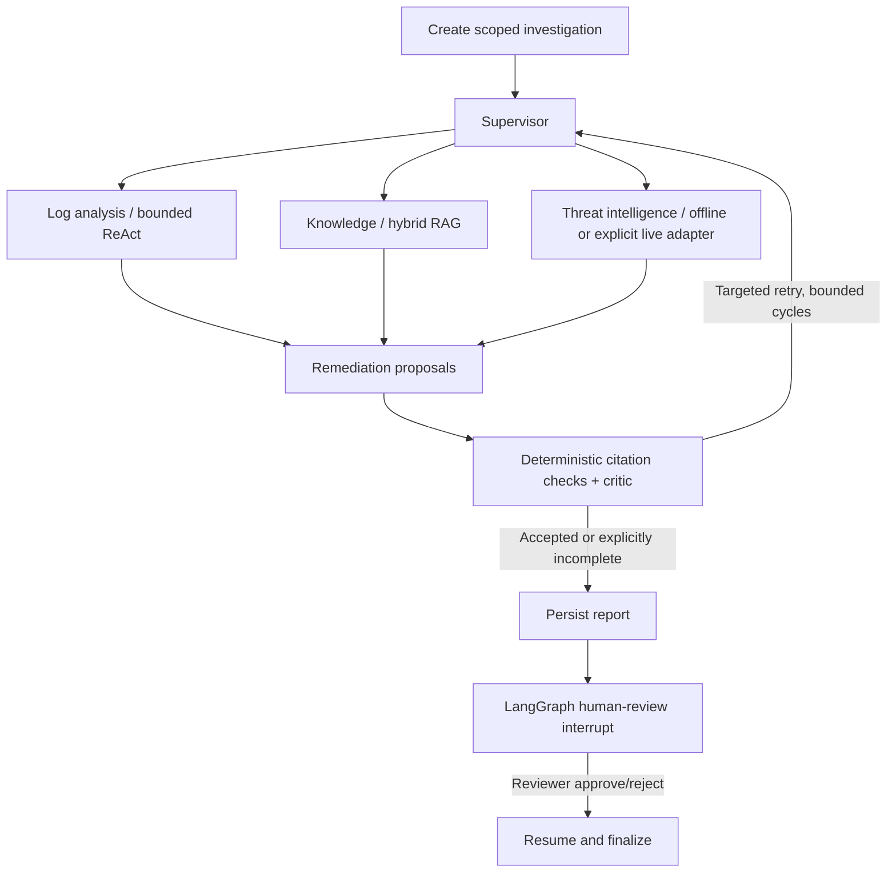

# SecOps AI

Local evidence-grounded cybersecurity investigation MVP. Phases 1–3 provide scoped ingestion, hybrid retrieval, persistent LangGraph investigations and human review. All demo records are synthetic. Mock output is explicitly labeled; no remediation is executed.

## Local startup (Windows PowerShell)

Docker Desktop must be running with Linux containers and WSL 2.

```powershell
.\scripts\setup.ps1
docker compose up --build -d
docker compose ps
docker compose exec backend python -m app.seed
```

Setup preserves an existing `.env`, otherwise copies `.env.example` and generates random local database, JWT and demo passwords. Read `DEMO_PASSWORD` in your local `.env`; never send it in chat or commit it. Frontend: http://localhost:5173. Swagger: http://localhost:8000/docs. API prefix: `/api/v1`. Database is not exposed by the default Compose file.

```powershell
docker compose logs -f backend
docker compose down
```

`down` preserves the database volume. Do not delete volumes unless you intend to delete all stored data.

## Architecture

FastAPI routes delegate to services; SQLAlchemy owns persistence, Alembic owns schema migrations. PostgreSQL 16 stores scoped records, JSONB events and 768-dimensional pgvector embeddings. React/Vite/TypeScript/Tailwind provides a minimal status shell; Swagger exposes the working Phase 2 tools. Redis is deferred by the specification.

Phase 3 adds this actual workflow:



The specialist nodes run in one LangGraph super-step with independent database sessions and reducer-backed state. PostgreSQL checkpoints persist compact state and references. A bounded local thread pool executes investigations asynchronously; it is not a durable distributed queue.

Configuration uses Pydantic settings. JWT signing keys must be random and at least 32 characters. Logs contain request IDs, status and measured duration, without request bodies, credentials or exception details. Readiness verifies database connectivity, extension and migration revision.

Dependency versions are resolved in `backend/uv.lock` and `frontend/package-lock.json`. Containers use Python 3.12; backend supports Python 3.12–3.13. The frontend uses Vite 6 for the installed Node 22.14 runtime compatibility.

## Development

```powershell
python -m pip install uv
docker compose -f compose.yaml -f compose.dev.yaml up -d db
. .\scripts\dev-env.ps1
cd backend
python -m uv sync --frozen
python -m uv run alembic upgrade head
python -m uv run uvicorn app.main:app --reload
```

In another terminal: `cd frontend; npm ci; npm run dev`. The Vite proxy routes `/api` to localhost:8000. The dev Compose override exposes PostgreSQL on loopback only for backend development and integration tests.

## Implemented capabilities

- Argon2id passwords, short-lived HS256 JWTs with issuer/audience validation, backend role checks and organization scoping. Login tokens contain user identity; current role and organization are loaded from the database on each request.
- Opt-in local registration creates analysts in the fixed demo organization only. Clients cannot choose role or organization. Registration is prohibited in production mode.
- CSV/JSON ingestion: UTF-8, 5 MB, 10,000 records, explicit timezone and IP normalization, 500-row SQL batches in one transaction. Any invalid row rejects the entire file with a row number. Duplicate `(organization, source, source_event_id)` records are counted and preserve the first stored event.
- PDF/TXT/Markdown ingestion: 10 MB uploads, UTF-8 text, signature and content checks, text PDF extraction, 200-page and 1,000,000-character caps. Encrypted, image-only, malformed and empty documents fail safely. No raw uploads are retained.
- Default chunks contain up to 400 whitespace-delimited words with 60-word overlap (approximately 400–600 tokens for typical English, not an exact tokenizer). Page and character offsets refer to normalized extracted text. Overlap and size are configurable.
- Document deduplication by organization/content SHA-256; transaction advisory locks prevent concurrent identical imports. Failed ingestion retains metadata and a safe error code. Re-upload the same bytes to retry. Re-upload after a provider/model change to transactionally replace embeddings; new chunk IDs invalidate old retrieval references.
- Exact pgvector cosine retrieval and PostgreSQL English full-text search; hybrid reciprocal rank fusion uses `sum(1/(60+rank))`, 10 candidates per mode by default and top 5 results. Top-K supports 1–20; candidate pools expand for K > 10. Organization, model, ready status, document IDs, exact title and content type are filtered before ranking. Semantic candidates require cosine similarity > 0.05.
- Context responses include database-validated chunk/document citations and bounded excerpts. Empty evidence returns insufficient knowledge. Mock answers quote source excerpts; they are not generated intelligence. Unknown usage metrics are `null`; durations are measured with a monotonic clock.
- Structured request logs, safe JSON errors, request IDs, upload bounds, per-process request throttling, database audit records, Swagger and liveness/readiness endpoints.
- Typed multi-agent orchestration with supervisor, log, knowledge, threat-intelligence, remediation, critic, reporting and review nodes. Deterministic citation checks cannot be waived by the critic, and reflection is bounded.
- Parameterized read-only tools derive tenant, alert identities and a two-hour event window from authorized database records. Model output cannot provide SQL or broaden organization scope.
- Reports persist validated evidence, timelines, tentative MITRE mappings, limitations and approval status. Review authorizes recommendations only and never executes them.
- Per-agent, tool and LLM-call records track measured latency, failures, available token usage and configured cost. Mock token/cost values remain null.

## Demo accounts and API use

Seed creates `analyst@secops.example` and `reviewer@secops.example`, both using the locally generated `DEMO_PASSWORD`. Reseeding does not reset existing passwords. It creates 150 failed logins followed by a success, four benign scheduled-job events, four alerts, a synthetic offline indicator and an authentication policy. No address is contacted.

In Swagger, POST `/auth/login`, copy the returned access token into **Authorize**, then upload sample files from `data/demo`. Query `/rag/query` with:

```json
{"query":"MFA active sessions","mode":"hybrid","top_k":5}
```

Prefix every path below with `/api/v1`. List endpoints use `limit` (20 by default, max 100) and `offset`, with stable timestamp/ID ordering.

| Method | Path | Access / purpose |
|---|---|---|
| GET | `/health/live`, `/health/ready` | Public health and provider label |
| POST | `/auth/register` | Public, only when explicitly enabled; analyst creation |
| POST | `/auth/login` | Public; JSON email/password |
| GET | `/auth/me` | Authenticated identity |
| GET / POST | `/alerts` | Both roles read; analyst creates |
| GET | `/alerts/{id}` | Scoped detail |
| POST | `/events/import` | Analyst; multipart `file` |
| GET | `/events` | Both; username, source_ip, event_type, outcome, start/end filters |
| POST | `/documents` | Analyst; multipart `file` |
| GET | `/documents`, `/documents/{id}` | Both; scoped metadata/status |
| POST | `/retrieval/search` | Both; semantic, keyword or hybrid sources |
| POST | `/rag/query` | Both; cited response and measured usage/latency |
| POST / GET | `/investigations` | Analyst creates; both roles list scoped investigations |
| POST | `/investigations/{id}/start` | Analyst starts a queued investigation |
| POST | `/investigations/{id}/resume` | Analyst resumes interrupted analysis; reviewer resumes persisted review |
| GET | `/investigations/{id}` | Scoped status, report and provider identity |
| GET | `/investigations/{id}/findings` | Structured specialist findings |
| GET | `/investigations/{id}/timeline` | Actual persisted agent runs |
| GET | `/investigations/{id}/evidence` | Scoped safe excerpts and source metadata |
| POST | `/investigations/{id}/review` | Reviewer approve/reject; rejection requires comment |
| GET | `/investigations/{id}/report` | Persisted cited report after reporting node |
| GET | `/investigations/{id}/metrics` | Measured execution, tool and provider usage when available |

Errors use `{ "error": { "code", "message", "request_id" } }`. Out-of-scope resource IDs return 404; filtered searches return no matching items. Failed document uploads return a safe error; inspect `/documents` for persisted failure status. Swagger `/docs` and schema `/openapi.json` are public API documentation, without data or credentials.

## Database schema

All tables have UUID primary keys. Timestamp fields use UTC `timestamptz`. Models and migration provide foreign keys, uniqueness and indexes; cross-organization document and investigation parent links use composite foreign keys.

| Table | Purpose / principal keys |
|---|---|
| `organizations` | Demo organization |
| `users` | Organization, unique email, Argon2id hash, analyst/reviewer role |
| `alerts` | Organization, event time, account/IP, severity hint, status |
| `security_events` | Organization/source/source_event_id uniqueness, normalized timestamp/account/IP, JSONB metadata |
| `documents` | Organization/SHA-256 uniqueness, format, processing/ready/failed status, model and reported usage |
| `document_chunks` | Document/index uniqueness, content, page/offsets, vector(768), model, generated English tsvector |
| `threat_indicators` | Scoped offline snapshot, classification, source and observation time |
| `audit_events` | Scoped actor/action/resource/time and safe structured details |
| `investigations` | Alert/initiator links, idempotency key, provider/model, thread ID, lifecycle, bounded attempt, report and measured active time |
| `evidence` | Scoped investigation source reference, safe excerpt and validation metadata |
| `agent_runs` | Per-node status, attempt, duration, prompt version and compact result |
| `tool_runs` | Allowlisted tool status, duration, errors and available embedding usage |
| `llm_calls` | Provider/model, status, latency, nullable tokens/TTFT/cost and errors |
| `reviews` | Unique reviewer decision, comment and timestamp |

Events have organization/account/time and organization/IP/time indexes; alerts and investigations have organization/time or status indexes. Chunks have GIN full-text and organization/model indexes. Exact cosine search is deliberate for the small corpus; no unbenchmarked HNSW index. Pool defaults: 5 connections + 5 overflow, pre-ping, 10-second acquisition timeout, 5-second connect timeout, 15-second SQL statement timeout. Embedding dimension is a fixed migration parameter, 768; changing it requires a new migration and reindexing.

Alembic applies on backend startup. Use `docker compose exec backend alembic check` to check drift. Back up PostgreSQL before schema changes. Downgrade removes application tables and data, so use it only in disposable databases; the test suite does this automatically in an isolated database. Do not share demo credentials or expose these services publicly.

## Gemini integration

Default `AI_PROVIDER=mock` never contacts Google, even if a key is present. The deterministic 768-dimensional token-hash embedding baseline is explicitly named `mock:token-hash-v1:768`; it is not a learned semantic model.

To opt in, configure your local `.env` securely: `AI_PROVIDER=gemini`, `ALLOW_EXTERNAL_AI=true`, `GEMINI_API_KEY`, `GEMINI_MODEL`, and `GEMINI_EMBEDDING_MODEL`. Use model IDs available to your account and an embedding model supporting 768 output dimensions. This opt-in permits sending queries and document excerpts to the provider and may incur charges. No keys belong in frontend variables or chat. Restart the backend and re-upload documents to reindex; the seeded mock index is intentionally invisible in Gemini mode.

The adapter uses the current [Google Gen AI SDK](https://googleapis.github.io/python-genai/), batched embeddings (32 items), retrieval task types, normalized vectors, structured answer schemas, bounded output and request timeouts. There is no silent fallback and no automatic retry. Generation usage comes only from provider-reported counters; embedding token usage is null when the SDK does not report it. Live model compatibility remains to be verified with an authorized smoke test.

Vertex support accepts `GOOGLE_GENAI_USE_VERTEXAI=true`, project/location and externally configured ADC. Credential mounting/provisioning is not automated or tested. No GCP resources were created.

## Testing

```powershell
# Run all Windows checks (uses a separate, disposable PostgreSQL test database)
.\scripts\test.ps1

# Run the HTTP smoke test after startup and seed
. .\scripts\dev-env.ps1
python scripts/smoke.py

# Run backend tests under container Python 3.12
docker compose run --rm backend uv run --frozen pytest -q

# Inspect production-only frontend dependencies
cd frontend
npm audit --omit=dev
```

The test database account needs CREATE DATABASE permission; the suite creates a random `secops_test_*` database, migrates, rolls back/reapplies the migration, exercises real pgvector and drops only that database. No SQLite substitute or live provider call is used. Tests cover authentication, role/organization boundaries, imports, duplicate detection, invalid/oversized uploads, PDF extraction, model filtering/reindex, RRF, mock determinism, citations, advisory locking, rate limits and provider contracts. CI configuration is included; remote CI has not been run.

Detailed executed commands, results and environment audit are in [docs/PHASE_1_2_VALIDATION.md](docs/PHASE_1_2_VALIDATION.md).

### Phase 3 demo and evaluation

```powershell
docker compose up --build -d --wait
docker compose exec backend python -m app.seed
. .\scripts\dev-env.ps1
python scripts\phase3_smoke.py

# Offline synthetic comparison; direct backend imports require this path.
$env:PYTHONPATH = "backend"
python scripts\evaluate_phase3.py
```

The smoke test logs in as analyst and reviewer, launches the seeded brute-force scenario, waits for the persistent review interrupt, validates report citations, approves recommendations without executing them, resumes the same checkpoint and prints measured metrics. Evaluation creates five synthetic investigations and reports actual measured latency, rule-aligned classification accuracy, citation validity and a policy-retrieval proxy. It is not a real-world benchmark.

Automated tests do not make live calls. Optional VirusTotal or AbuseIPDB lookup requires `THREAT_INTEL_PROVIDER`, `ALLOW_EXTERNAL_INTEL=true`, and the corresponding local API key. Reserved/private IPs and synthetic domains are never sent externally; provider failures do not silently fall back.

## Directory structure

```text
SecOps-AI/
  AGENTS.md, README.md, .env.example, .gitignore
  compose.yaml, compose.dev.yaml
  backend/
    pyproject.toml, uv.lock, Dockerfile, alembic.ini
    migrations/versions/0001_phase_1_and_2_schema.py
    app/
      main.py, config.py, db.py, errors.py
      api/                 # thin auth, alerts, events, documents, investigations routes
      models/              # SQLAlchemy schema contracts
      schemas/             # Pydantic request/response validation
      services/            # ingestion, retrieval, tools, investigation lifecycle and metrics
      ai/                  # embedding/agent providers and versioned prompts
      graph/               # typed state, PostgreSQL checkpoints and workflow
      observability/       # allowlisted JSON logging
      seed/                # deterministic synthetic scenarios
    tests/                 # unit and real PostgreSQL integration tests
  frontend/
    package.json, package-lock.json, Dockerfile, nginx.conf
    vite.config.ts, tsconfig.json, index.html
    src/main.tsx, src/style.css
  data/demo/               # sample CSV, JSON and policy
  scripts/                 # secure local setup, dev environment, tests, HTTP smoke
  docs/                    # specification, checklist, validation evidence
  .github/workflows/ci.yml
```

## Known limits

- Local prototype, not production-ready. Application-level tenant checks are tested; database row-level security, SSO, refresh/revocation tokens, distributed throttling and durable workers are deferred. Registration grants access to the shared demo organization and must remain local-only.
- Mock embeddings measure hashed token similarity; live semantic quality and Gemini/Vertex connectivity are untested. Citation checks prove source existence, ownership and excerpt integrity, not semantic entailment of generated prose. Untrusted source text can be quoted, but has no tool authority.
- Ingestion is synchronous and holds a database transaction while embedding. PDF extraction has caps but is not an isolated hostile-file sandbox; use only authorized local documents. No OCR, virus scanning, binary storage or durable ingestion queue.
- Metrics are per-response latency/available usage plus request logs; no historical metrics dashboard, cost estimates, evaluation benchmark or advanced tracing. Missing usage remains null.
- The Phase 3 executor is a bounded in-process thread pool. Database state and checkpoints survive restarts, but queued memory tasks do not; startup marks orphaned running work interrupted for explicit resume.
- External intelligence is disabled by default. Live Gemini, VirusTotal and AbuseIPDB connectivity has not been tested in this repository session.
- ATT&CK mappings are deterministic hypotheses tied to observed synthetic rule categories, not proof that a technique occurred.
- `npm audit` reports four high-severity development dependency findings via picomatch/fdir/tinyglobby/Vite. `npm audit --omit=dev` reports zero. The current registry offers no patched picomatch above 4.0.7; audit's suggested Vite downgrade was not applied without compatibility/security evidence. The shipped frontend container serves static assets with nginx; Vite development tooling should remain local. Track an upstream fix.
- The test client emits an upstream Starlette/httpx deprecation warning. Tests pass; this warning is not suppressed.
- Windows `npm ci` can encounter EPERM when tooling holds native module files open. Close the locking tools and retry, or use the verified Docker build. A local `npm install` and build succeeded after this occurred during validation.
- The frontend is intentionally a status shell with a Swagger link. Advanced dashboard and investigation screens are outside these phases.

## Scope and next phase

Phase 3 is implemented in the backend. Advanced React investigation screens, durable distributed workers, GCP deployment and advanced observability remain outside this phase. See [PROJECT_STATUS.md](PROJECT_STATUS.md) for current validation evidence and exact continuation steps.
