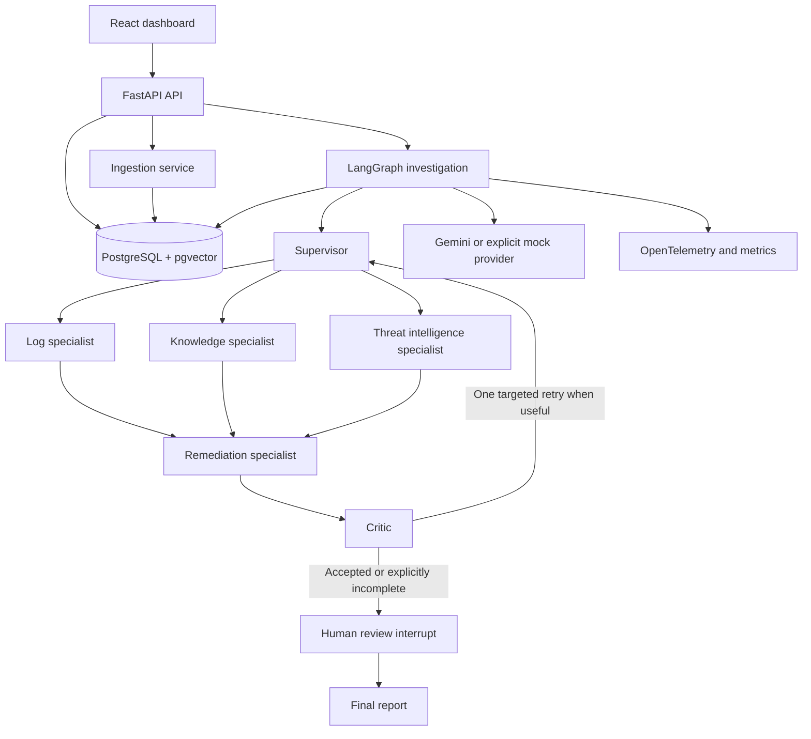

# SecOps AI — Product and engineering specification
Version 1.0 | 17 November 2026 | Implementation target: one-day demonstrable MVP

## 1. Product vision
Build an evidence-grounded security operations assistant that turns an alert into an auditable investigation report. The primary user is a SOC analyst; the secondary user is a security team lead reviewing findings. The application works on seeded synthetic security events and uploaded, authorized documents. It does not scan networks, execute remediation, or contact suspicious hosts. It is a portfolio prototype, not a certified production security product.

Example: an account experiences repeated failed logins followed by a successful login from an unusual source. SecOps AI retrieves relevant events and organizational policies, checks an offline threat-intelligence snapshot, produces cited findings, identifies uncertainties, recommends actions for review, and records the analyst's decision.

### Success criteria
- From a fresh checkout, one documented Docker Compose command starts a working local demo without API credentials.
- A real Gemini provider can be enabled through environment configuration; mock mode is visibly labeled and never silently substituted for live mode.
- Structured events persist in PostgreSQL, document chunks and real-mode embeddings in pgvector; retrieval returns source IDs and excerpts.
- LangGraph actually orchestrates specialist nodes and conditional review; a bounded retry/reflection path and persisted checkpoint are demonstrable.
- A user can create an investigation, see its timeline, inspect cited evidence, approve/reject recommendations and view the final report after refreshing the page.
- Tests exercise a positive case, benign case, failure scenario, authorization, and review; metrics reflect actual recorded executions, not invented measurements.

## 2. Scope and prioritization
P0 (today): local Compose environment; one seeded demo organization; analyst/reviewer authentication; JSON/CSV log ingestion; Markdown/text/PDF knowledge ingestion (text PDFs only, no OCR); hybrid retrieval; supervisor plus specialist agents; report and approval; metrics; tests; README.
P1 (today only after P0 is stable): real Gemini smoke test, offline evaluation script, GCP deployment config and optionally actual deployment with user-provided credentials.
P2 (later): streaming Pub/Sub ingestion, independent durable worker queue, Redis, external threat intelligence integrations, multi-tenant isolation, SSO, full audit retention, load tests, public deployment hardening. No autonomous remediation, live target probing, or malware functionality.

## 3. Architecture

Diagram is conceptual; implement sequential specialist dispatch first to avoid concurrent state-write complexity. A graph supervisor chooses permitted specialist tasks, and the graph enforces required evidence collection. After P0, parallelize independent branches with appropriate reducers and a join barrier. The service owns authorization, validation, state transitions, and persistence; the model never owns access control.

### Stack choices
Python 3.12, FastAPI, Pydantic v2, SQLAlchemy 2, Alembic, psycopg 3, PostgreSQL 16 with pgvector, LangGraph and its PostgreSQL checkpoint package, google-genai, OpenTelemetry, Pytest, React + Vite + TypeScript + Tailwind, TanStack Query, Recharts, Docker Compose. Use a supported Node LTS, verify compatible package versions and commit lockfiles. Avoid extra infrastructure until the core works. Use the current Google Gen AI SDK (not legacy generative modules); model IDs are configuration, not invented constants. A single backend process is sufficient for local MVP.

## 4. Repository structure (proposed)
```text
secops-ai/
  AGENTS.md
  README.md
  docs/PROJECT_SPEC.md
  docs/IMPLEMENTATION_PLAN.md
  .env.example
  .gitignore
  compose.yaml
  backend/
    pyproject.toml
    Dockerfile
    alembic.ini
    migrations/
    app/
      main.py
      config.py
      db.py
      models/
      schemas/
      api/                 # auth, alerts, documents, investigations, metrics
      services/            # ingestion, retrieval, permissions, reports
      ai/                  # provider interface, Gemini, mock, prompts
      graph/               # state, nodes, routing, graph builder
      observability/
      seed/
    tests/
  frontend/
    package.json
    Dockerfile
    src/
      api/
      components/
      pages/
      types/
  data/demo/               # synthetic seed events and sample policies
  scripts/                 # seed, evaluation, smoke test
  deploy/                  # GCP instructions and optional scripts
  .github/workflows/ci.yml
```

## 5. Data model
Use UUID primary keys, UTC timestamptz, foreign keys, database constraints, indexes and explicit migrations. Keep one fixed demo organization today; scope all user-facing data to organization_id even in single-org mode. Store passwords only as strong hashes (Argon2id or bcrypt). Never include credentials or raw authorization headers in logs.

| Table | Core fields |
|---|---|
| organizations | id, name |
| users | id, organization_id, email unique, password_hash, role (analyst/reviewer) |
| alerts | id, organization_id, title, description, event_time, source_ip, username, severity_hint, status, created_at |
| security_events | id, organization_id, source, source_event_id, timestamp, event_type, source_ip, username, outcome, metadata jsonb; unique(org, source, source_event_id) |
| documents | id, organization_id, title, filename, sha256, content_type, ingestion_status, created_at; unique(org, sha256) |
| document_chunks | id, organization_id, document_id, chunk_index, page nullable, content, embedding vector(D), embedding_model, search_vector tsvector; unique(doc, chunk_index) |
| threat_indicators | id, organization_id, indicator_type, value, classification, source, observed_at |
| investigations | id, organization_id, alert_id, initiated_by, status, graph_thread_id unique, attempt, report jsonb nullable, error_code nullable, created_at, updated_at |
| evidence | id, organization_id, investigation_id, kind, source_ref, excerpt, metadata jsonb, created_at |
| agent_runs | id, investigation_id, agent, attempt, status, started_at, ended_at, input_tokens nullable, output_tokens nullable, cost_usd nullable, model, trace_id, error_code nullable |
| reviews | id, investigation_id unique, reviewer_id, decision, comment, reviewed_at |
| audit_events | id, organization_id, actor_id nullable, action, resource_id, created_at, details jsonb |

Index events by (organization_id, username, timestamp) and (organization_id, source_ip, timestamp); alerts by org/time; investigations by org/status; chunk text with GIN. Use vector cosine search with exact retrieval for small demo data, optionally add HNSW after benchmarking and verifying dimensions. D is a fixed documented migration parameter (default 768); request that output dimension from a compatible embedding model or document and migrate deliberately. Mock embeddings are deterministic and separately labeled; never mix embedding models in a retrieval query. Re-index when models change. Keep checkpoint tables managed by LangGraph's supported setup mechanism, using the same database but separate internal tables. Scope access to threads through the investigations table.

## 6. Ingestion and retrieval
Structured pipeline: accept CSV/JSON (max 5 MB and 10,000 rows); validate each item with Pydantic; normalize timestamps and IP addresses; reject malformed records with row numbers; transactionally upsert using source IDs; return accepted/duplicate/rejected counts. Prefer atomic rejection for invalid batch schema; document whether row-level partial acceptance is applied. Seed a reproducible suspicious case and a benign case. Never use actual personal account data.

Unstructured pipeline: authenticated document upload, 10 MB limit, allow PDF/TXT/MD, validate actual content type, reject encrypted/unreadable PDFs, extract via pypdf, cap extracted characters and pages, chunk roughly 400–600 tokens with 60–100 overlap, preserve source file/page offsets, embed in batches, store in DB. Deduplicate by SHA-256. Only ready documents participate in retrieval. No raw binary retention required for local demo; GCS is a later storage adapter. Handle failures as failed document status with safe message; retry idempotently.

Hybrid retrieval: scoped lexical search (Postgres full text) and cosine search, top 10 each, combine with reciprocal rank fusion score sum(1/(60+rank)); deduplicate by chunk ID and return top 5. Apply org/model filters before ranking. Provide chunk ID, document ID, title, page, excerpt and score, cap prompt evidence. If no useful evidence, say insufficient knowledge instead of fabricating a policy. Reranking optional P1. Never send uploaded instructions as system prompts.

## 7. Agent orchestration
Graph state: investigation_id, alert_id, organization_id, plan (enum tasks), completed_tasks, attempt, evidence_ids, specialist_findings, draft_report, critic_feedback, review_decision, error_code. Persist compact structured summaries and references; avoid raw documents, full logs, passwords, or unbounded messages in checkpoints. All state fields typed; graph routing validated and bounded. Store evidence/report in DB; retries use deterministic keys or upserts. Graph thread_id = investigation UUID. Configure checkpoint saver for every invocation; initialize once at startup. Use installed LangGraph version documentation for interrupt and resume API. Do not put external writes before interrupt in a node unless idempotent (node may replay on resume).

| Node | Inputs and behavior | Outputs |
|---|---|---|
| supervisor | Alert plus prior critique; creates plan from allowlist; required evidence tasks cannot be skipped by model | Bounded plan and route |
| log_analysis | Calls typed read-only query tools for time-window events and login aggregates; ReAct-style bounded tool selection | Findings with event evidence IDs |
| knowledge | Calls hybrid retrieval for relevant organizational policies | Policy findings and chunk evidence IDs |
| threat_intel | Looks up normalized indicator in local seeded threat table, never probes IP; clearly marks unknown or stale | Indicator evidence or unknown |
| remediation | Uses gathered evidence; recommends only reviewable defensive actions | Draft report |
| critic | Checks schema, citation existence/ownership, evidence support, contradictions and missing evidence; can request targeted retry | Accept or retry once; otherwise incomplete |
| review | LangGraph interrupt with report summary; API requires reviewer role to resume; no security action executed | Approve/reject with comment |
| finalize | Persists final report, decision and audit trail idempotently | Terminal status |

Bound tool calls (e.g. 4 per specialist, 12 per run), evidence results (e.g. 100 events per query, 5 retrieved chunks), graph retries (1 critique-driven round), provider timeout (30 s), graph deadline (120 s, configurable), and total prompt/output tokens (provider-supported caps). Log only decision summaries/tool arguments after redaction; do not expose hidden model reasoning. Require JSON schema validation for generated findings; retry malformed output once within budget. If provider fails, show failed or incomplete investigation, retain evidence, and do not manufacture conclusions. Deterministic tools: get_auth_events(username, start, end), get_ip_events(ip,start,end), count_failed_logins(username,start,end), search_policies(query), lookup_indicator(ip). Never allow arbitrary SQL or shell commands from LLM. Query arguments derive from authorized alert context and bounded windows; parameterize all SQL.

### Report contract (illustrative payload)
```json
{
  "summary": "Repeated failures and a subsequent success require review.",
  "severity": "high",
  "confidence": "medium",
  "findings": [{"id":"f1","claim":"Multiple failures preceded a success","evidence_ids":["<uuid>"]}],
  "recommendations": [{"action":"Review active sessions and consider revocation","rationale":"Possible account compromise","evidence_ids":["<uuid>"],"requires_approval":true}],
  "limitations": ["No independent verification of account ownership"],
  "review": null
}
```
Severity enum info/low/medium/high/critical; confidence low/medium/high (qualitative, not a calibrated probability). Every factual claim requires DB-verified evidence belonging to the investigation. Recommendations must be suggestions, not executed operations. Unknown evidence is explicitly unknown. Avoid arbitrary risk scoring: define simple labeled rules and allow analyst disagreement.

### Lifecycle
queued -> running -> awaiting_review -> approved or rejected. queued/running -> failed on unrecoverable error; incomplete reports may go to review with limitations, explicitly marked. Approved means approval of recommendations only. Use conditional DB updates and a per-investigation lock (database advisory lock or row-based claim) to prevent duplicate workers/reviews. Use API idempotency via client-generated request key or unique request field. Implement local single-process bounded execution (e.g. thread pool with DB-backed state) and reconcile orphaned running jobs on startup to failed/interrupted, allowing explicit retry with new investigation ID; do not claim durable job queue. Persist checkpoints and review across restart. Do not run local background workers on Cloud Run with request-only CPU; see deployment section.

## 8. REST API contracts
Prefix `/api/v1`; JSON unless multipart. Bearer token required except login and health. Return consistent errors `{error:{code,message,request_id}}`; no raw provider/SQL exceptions. Validate ownership on every resource; 401 unauthenticated, 403 wrong role, 404 not found/outside scope, 409 invalid transition/duplicate in-progress, 422 invalid data, 429 rate limit. Paginate list routes using limit (default 20, max 100) and offset; stable sort by timestamp/id. Use OpenAPI generated by FastAPI.

| Method and path | Request / response | Role |
|---|---|---|
| POST /auth/login | email,password -> access_token, token_type, user | public |
| GET /auth/me | current user | authenticated |
| GET /alerts | status, severity, limit, offset -> items,total | both |
| POST /alerts | title,description,event_time,source_ip,username -> alert | analyst |
| POST /events/import | multipart file -> import summary | analyst |
| POST /documents | multipart file -> document metadata/status | analyst |
| GET /documents | paginated metadata | both |
| POST /investigations | alert_id, request_id -> 202 investigation | analyst |
| GET /investigations | paginated list | both |
| GET /investigations/{id} | status, report, timestamps, decision, error | both |
| GET /investigations/{id}/timeline | actual node runs chronological | both |
| GET /investigations/{id}/evidence | evidence with safe excerpts | both |
| POST /investigations/{id}/review | decision approve/reject, comment -> updated state or 202 | reviewer |
| GET /metrics | from,to -> metrics and per-agent breakdown | both |
| GET /health/live | status | public |
| GET /health/ready | DB and required local services ready; no secrets | public |

Use short-lived access tokens, strong secret from environment, explicit CORS origins; no refresh token needed in local MVP. UI stores token in memory, re-login after refresh if needed; server persistence remains intact. Protect uploads, enforce size before parsing and avoid serving raw HTML. Demo accounts via seed and configurable local-only credentials, never automatically created in production mode.

## 9. Frontend experience
Design a responsive SOC dashboard with dark/light neutral slate palette, accessible contrast, status badges and readable typography, not a generic chat UI. Use TanStack Query polling every 2 seconds while queued/running, stop at review/terminal. Provide loading/empty/error views and retry; render model text as text or sanitized markdown, not raw HTML.

- Login: demo credential instructions only for local mode, role indication.
- Overview: alerts by severity, recent investigations, actual summary metrics; visible mock/live banner.
- Alerts: sortable/filterable list, details panel, create alert, import logs, launch investigation.
- Investigation detail: status/timeline with real agents, findings, severity/confidence, clickable evidence drawer, recommendations, limitations, reviewer approval/rejection (comment required on rejection), report export as JSON or Markdown. Disable review for analyst and enforce backend too.
- Knowledge base: file upload, ingest status, document list, model/index mode.
- Observability: time-range selector, request count, actual token usage/cost, p50/p95 latency, per-agent duration/error rate, evaluation results if run. Use null or N/A when no measurements; never show invented chart data.

## 10. Observability and evaluation
Create a trace per investigation, span per node and provider/tool invocation, correlate request ID/investigation ID/trace ID. Use OpenTelemetry SDK with console exporter locally (optional OTLP endpoint); do not log prompts, full evidence, secrets, or sensitive user identifiers. Record provider-reported token usage, model ID, start/end times and errors. Cost = sum(input_tokens * configured input USD per million + output_tokens * configured output USD per million)/1e6; missing usage or price -> null, not zero. Throughput = output tokens / generation duration when both present; distinguish end-to-end provider rate from streaming token-generation rate. p95 = nearest-rank or documented percentile method over completed runs. Track success/failed/incomplete separately; approval isn't proof of accuracy. Record cache and retry counters if implemented. Mock runs excluded from actual LLM cost and throughput aggregates or separately labeled.

Offline evaluation: create at least 6 synthetic labeled cases (brute-force suspected, benign scheduled job, unusual login, policy absent, indicator unknown, malicious text embedded in policy). Evaluate claim evidence validity, expected severity band, retrieval recall@5 against known relevant chunk IDs, success status, latency and tokens. Compare rule/mock baseline and real model if available; produce machine-readable results, no fabricated benchmark. Human review of a sample is necessary before claims of factual quality. Add `scripts/evaluate.py` with documented invocation and expected labels.

## 11. Security and failure handling
Threat model: prompt injection in documents/logs, unauthorized access, malformed uploads, secret exposure, duplicated jobs, hallucinated evidence, unsafe recommendations, model outages. Treat retrieved strings as data; separate instructions and evidence using structured payloads; tool allowlist and read-only access enforced in code. Refuse tool calls with unauthorized IDs or out-of-window dates; validate citation IDs outside the model. Apply input length and upload caps, basic per-user throttling, bounded execution, parameterized DB queries, redaction, no outbound lookup in MVP, no auto-remediation. Do not publish demo credentials to a public service. Provide backup/migration and deletion notes for later production. Security controls reduce risk but are not a guarantee; document untested areas.

## 12. Local runtime and configuration
Example `.env.example` (no real secrets):
```dotenv
APP_ENV=development
AI_PROVIDER=mock
DATABASE_URL=postgresql+psycopg://secops:local_dev_only@db:5432/secops
JWT_SECRET=replace-with-local-random-secret
CORS_ORIGINS=http://localhost:5173
GEMINI_API_KEY=
GEMINI_MODEL=
GEMINI_EMBEDDING_MODEL=
EMBEDDING_DIM=768
GOOGLE_CLOUD_PROJECT=
GOOGLE_CLOUD_LOCATION=
GOOGLE_GENAI_USE_VERTEXAI=false
LLM_INPUT_USD_PER_MILLION=
LLM_OUTPUT_USD_PER_MILLION=
OTEL_EXPORTER_OTLP_ENDPOINT=
```
Provider settings: support mock first; use Google Gen AI SDK with Gemini API key when configured, or Google Cloud ADC in Vertex mode when opted in. Verify SDK configuration and available model IDs for chosen region before a real call. Never set a fake default model in live mode; fail configuration clearly. Do not include any API key in frontend env. Ensure Compose injects env, startup DB readiness checks, migrations, and a separate idempotent seed command; README specifies exactly how. On Windows use PowerShell `Copy-Item .env.example .env`; document `docker compose up --build -d`, `docker compose ps`, `docker compose logs -f backend`, test and seed commands based on implementation; Docker Desktop running required. Host frontend 5173, API 8000, avoid exposing DB unless needed locally. Pin verified container tags and use non-root backend where feasible.

## 13. GCP deployment design (P1, optional actual launch)
Target: Cloud Run web/API, Cloud SQL PostgreSQL with pgvector, Gemini via Google Cloud service account/ADC, Secret Manager for credentials, Artifact Registry images, Cloud Logging/Trace; optional Cloud Storage for document binaries. Provision project/billing/API access and least-privilege service accounts first; do not create billable infrastructure without user's explicit approval. Serve frontend via same origin or explicitly configure allowed origins. Use Cloud SQL connector or supported Cloud Run Cloud SQL integration, secure network and connection pooling, migration via one-off job. Check extension installation permissions. For local executor parity, deploy only private demonstration service with single instance and instance-based CPU allocation if relying on background work, and acknowledge interruption risk. Preferred next step: Cloud Tasks or Pub/Sub with separate authenticated worker endpoint, idempotent jobs and retries, no request-only CPU background assumptions. Document service timeout and scaling limits. Do not mark cloud deployment complete unless deployed and smoke-tested. Provide cleanup steps and budget alert guidance (alerts are not spending caps). No public endpoint with seeded accounts. Cloud deployment credentials and exact costs are not provided here.

## 14. Acceptance and test matrix
| Scenario | Expected outcome |
|---|---|
| Clean start with no API key | Mock-labeled app boots; migrations and seed succeed |
| Import logs twice | No duplicates; counts accurate |
| Invalid CSV or oversized document | Safe 4xx, no unauthorized/partial writes per documented rule |
| Upload policy and retrieve | Correct excerpt and source ID; no cross-org leakage |
| Suspicious case | Report cites real events/policy, shows limitations and awaits approval |
| Benign case | No fabricated compromise or indicator |
| Critic sees invalid evidence | Reject citation, bounded retry, incomplete if unresolved |
| Prompt injection inside document | Cannot alter tool authority or trigger actions |
| Provider error/timeout | Safe failed/incomplete status; no fake success |
| Duplicate run/review submission | No duplicate side effects; conflict or idempotent response |
| Restart while awaiting review | Same persisted thread resumes after reviewer approval |
| Analyst attempts approval | 403; no state change |
| Unauthorized resource ID | 404; no data leak |
| Reviewer rejects | Terminal rejected with comment, no remediation |
| Metrics without live runs | clearly N/A for live model tokens/cost |
| UI build and API tests | pass or openly record failures and reproduction |

Unit tests: parsers, RRF, schemas, routing, citation validator, metric calculations, role guards. Integration tests: database & pgvector, HTTP auth/import/investigate/review, checkpoint across graph re-instantiation, idempotency. Use deterministic fake provider and test DB; mark real-provider tests opt-in. Run frontend typecheck/build, at least one end-to-end test or scripted smoke test. Never skip failed tests to claim completion.

## 15. Demo script (3–5 minutes)
1. Start Compose, seed data, log in as analyst.
2. Open suspicious alert and click Investigate; watch agent timeline.
3. Open findings and verify event/policy evidence excerpts; show offline indicator status.
4. Sign in as reviewer; approve/reject and export report. Explain approval is not execution.
5. Show traces and metrics, then compare benign case and evaluation results.
6. Explain local mock vs live inference, state persistence, cloud target and remaining hardening.

## 16. JD traceability
Python/DSA: typed Python, RRF, graph routing, indexed retrieval and deduplication. Structured/unstructured data: two ingestion paths and normalized metadata. Vector/RAG: pgvector plus lexical fusion and citations. Multi-agent: supervisor and specialized bounded tool agents, critic, persisted graph. Cloud: genuine GCP deployment when available, otherwise deployment design only. Metrics: usage, latency, throughput, cost and node tracing. Technical discovery: interview real analysts or mentors later; record actual pain points, requirements and validation; do not invent stakeholder sessions. Production lifecycle: tests, containerization, CI, demo and explicit limits; actual production-grade claims require further security, durability and operational validation.

## 17. Reference documentation
- Codex repository guidance: https://learn.chatgpt.com/docs/agent-configuration/agents-md
- LangGraph: https://docs.langchain.com/oss/python/langgraph/overview
- LangGraph interrupts: https://reference.langchain.com/python/langgraph/types/interrupt
- LangGraph checkpoint docs: https://github.com/langchain-ai/docs/blob/main/src/oss/langgraph/checkpointers.mdx
- Google Gen AI SDK: https://googleapis.github.io/python-genai/
- pgvector: https://github.com/pgvector/pgvector
- FastAPI: https://fastapi.tiangolo.com/
- OpenTelemetry Python: https://opentelemetry.io/docs/languages/python/
- Cloud Run: https://cloud.google.com/run/docs
- MITRE ATT&CK: https://attack.mitre.org/ (for later enrichment; review attribution and licensing)
